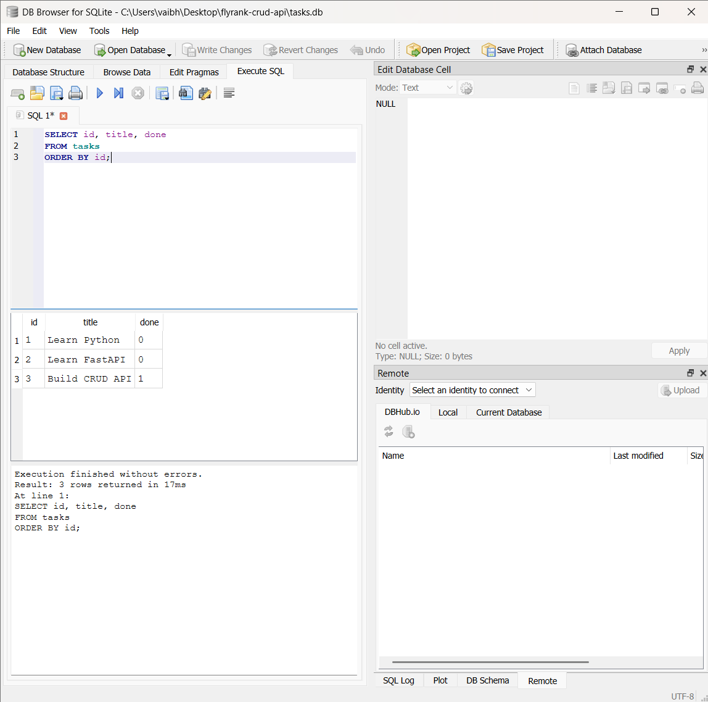

# FlyRank AI CRUD API

A task management REST API built using Python and FastAPI as part of the FlyRank AI Back-End AI Internship.

**GitHub Repository:** https://github.com/25A31A42J5/flyrank-crud-api

## Assignment 2: Connecting CRUD to a Database

This assignment upgrades the original in-memory CRUD API to use SQLite for persistent data storage.

### Features

- Create, read, update, and delete tasks.
- Store tasks persistently using SQLite.
- Automatically create the database and tasks table.
- Insert three sample tasks only when the tasks table is empty.
- Validate incoming request data.
- Return appropriate HTTP status codes.
- Use parameterized SQL queries to safely handle user input.

## Technologies Used

- Python
- FastAPI
- SQLite
- Pydantic
- Uvicorn

## Project Structure

```text
flyrank-crud-api/
├── main.py
├── requirements.txt
├── README.md
├── .gitignore
└── docs/
    └── database-query.png
```

**Note:** `tasks.db` is generated automatically when the application starts. It is excluded from Git using `.gitignore`, so it will not appear in the repository unless deliberately added.

## Installation and Setup

### 1. Clone the repository

```powershell
git clone https://github.com/25A31A42J5/flyrank-crud-api.git
cd flyrank-crud-api
```

### 2. Create a virtual environment

```powershell
python -m venv .venv
```

### 3. Activate the virtual environment

On Windows PowerShell:

```powershell
.venv\Scripts\Activate.ps1
```

### 4. Install dependencies

```powershell
pip install -r requirements.txt
```

### 5. Start the application

```powershell
uvicorn main:app --reload
```

The application automatically creates `tasks.db` and the `tasks` table if they do not exist. If the table is empty, three sample tasks are inserted.

Open the interactive API documentation:

http://127.0.0.1:8000/docs

## Database Design

SQLite is used because it is lightweight, requires no separate database server, and can be accessed through Python's built-in `sqlite3` module.

### Tasks Table

| Column | Data Type | Description |
|---|---|---|
| `id` | INTEGER | Primary key; automatically generated |
| `title` | TEXT | Task title |
| `done` | INTEGER | Completion status: `0` for incomplete and `1` for complete |

The database file is named `tasks.db` and is created in the application's working directory.

## API Endpoints

| Method | Endpoint | Description | Success Status |
|---|---|---|---|
| GET | `/tasks` | Retrieve all tasks | 200 OK |
| GET | `/tasks/{task_id}` | Retrieve a task by ID | 200 OK |
| POST | `/tasks` | Create a task | 201 Created |
| PUT | `/tasks/{task_id}` | Update a task | 200 OK |
| DELETE | `/tasks/{task_id}` | Delete a task | 204 No Content |

Invalid request bodies return HTTP 400. Requests for nonexistent task IDs return HTTP 404.

### Example: Create a Task

Request body:

```json
{
  "title": "Learn SQLite"
}
```

Example response:

```json
{
  "id": 4,
  "title": "Learn SQLite",
  "done": false
}
```

The generated ID depends on the current database contents.

### Example: Update a Task

Request body:

```json
{
  "title": "Learn SQLite thoroughly",
  "done": true
}
```

## SQL Query Verification

The following query retrieves all tasks in ascending order of their IDs:

```sql
SELECT id, title, done
FROM tasks
ORDER BY id;
```

This query was executed in DB Browser for SQLite to verify the database contents.

### Database Query Screenshot



## Data Persistence

Task data is stored in SQLite instead of an in-memory Python list. Created and updated tasks remain saved when the application restarts.

The application inserts the three sample tasks only when the tasks table is empty, preventing duplicate seed tasks on subsequent restarts.

## Error Handling and SQL Safety

- Request data is validated using Pydantic.
- Invalid request bodies return HTTP 400.
- Missing task IDs return HTTP 404.
- Parameterized SQL queries are used instead of concatenating user input into SQL statements.
- Database connections are managed using Python's SQLite support.

## Internship Assignment

- **Program:** FlyRank AI Back-End AI Internship
- **Assignment:** Connecting Your CRUD to the Database
- **Language:** Python
- **Framework:** FastAPI
- **Database:** SQLite